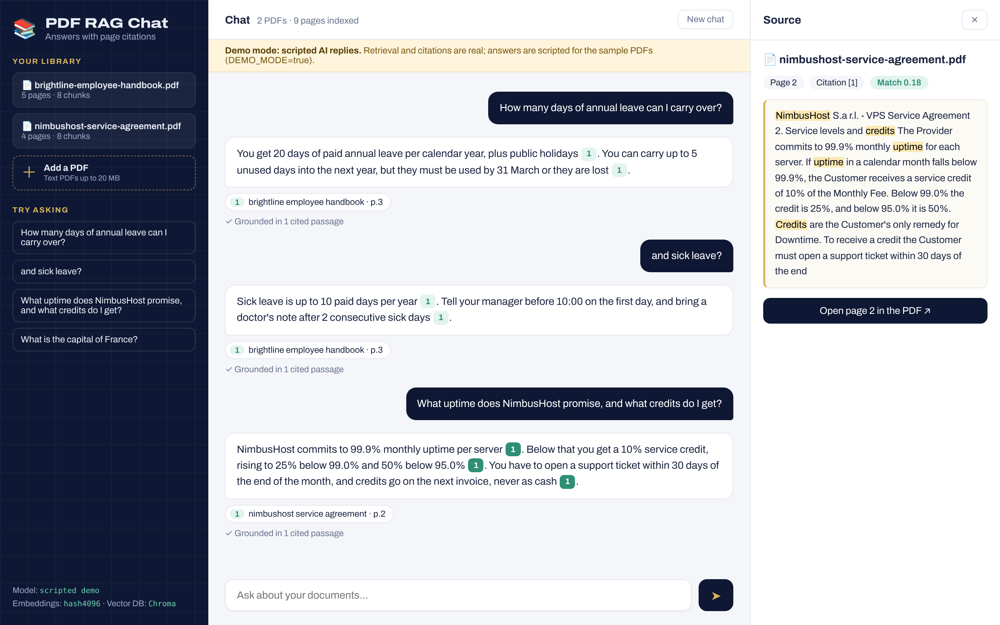

# 📚 PDF RAG Chat

> **Day 5 of [30 Days of AI Agents](https://github.com/obiokoye)**: chat with your PDFs and get answers that cite the exact page, with every citation checked before you see it.




## What it shows

- **RAG (retrieval-augmented generation)**: PDFs are split into overlapping chunks, embedded, and stored in **Chroma**. Each question pulls the top 4 chunks and the model answers only from those.
- **Page-level citations**: chunks never cross a page boundary, so every chunk knows its file and page. The model is told to cite sources as `[1]`, `[2]`, and the UI turns them into clickable chips that open the passage and the PDF at that page.
- **Citation verification**: after the model replies, `verify_citations` keeps only numbers that point at a real retrieved source and strips invented ones. An answer with no valid citation is flagged "No source cited" instead of looking trustworthy.
- **Refusing when retrieval finds nothing**: if no chunk scores above the relevance threshold, the app answers "I couldn't find that in your documents." **without calling the model**, which saves tokens and stops made-up answers.
- **Follow-up questions**: short follow-ups like "and sick leave?" are searched together with the previous question, and the last 3 turns go to the model as chat history.
- **Prompt-injection hygiene**: document text is wrapped in `<source>` tags and the system prompt says it is untrusted data, never instructions.
- **Safe uploads**: PDF magic-bytes check, 20 MB limit, and file names sanitised so an upload can't write outside `data/pdfs/`.
- **Swappable providers + demo mode**: Gemini (default), Groq, OpenAI or Anthropic through one OpenAI-compatible client, or scripted replies with no key at all.
- **Tests without API keys**: 39 pytest tests (chunking, retrieval, citation checks, the FastAPI endpoints) run offline in CI on every push.

## Quick start

```bash
git clone https://github.com/obiokoye/pdf-rag-chat.git
cd pdf-rag-chat
python -m venv .venv && source .venv/bin/activate
pip install -r requirements.txt
cp .env.example .env    # add a free Gemini key from https://aistudio.google.com/apikey (or leave it empty for demo mode)
python main.py serve
```

Open **http://localhost:8000**. The two sample PDFs in `samples/` are indexed automatically the first time.

### Windows (PowerShell or cmd)

```bat
git clone https://github.com/obiokoye/pdf-rag-chat.git
cd pdf-rag-chat
python -m venv .venv
.venv\Scripts\activate
pip install -r requirements.txt
copy .env.example .env
python main.py serve
```

### Command line

```bash
python main.py ask "How many days of annual leave can I carry over?"
python main.py chat                    # terminal chat with the same citations
python main.py ingest contracts/ my.pdf   # add PDFs (files or folders) to the index
```

## Demo mode

Set `DEMO_MODE=true` in `.env`, or leave every API key empty, and the app shows **"Demo mode: scripted AI replies"**. In demo mode:

- **Retrieval is real**: chunking, Chroma search, relevance threshold and citation checks all run for real.
- **Answers are scripted** for questions about the sample PDFs (annual and sick leave, uptime credits, backups, expenses, remote work, cancelling). The scripted answer can only cite a page if retrieval actually returned it.
- Other questions get the closest passage from the top source, quoted with its citation. Off-topic questions ("What is the capital of France?") are refused before any model call.
- Embeddings use the offline `hash` embedder, so nothing is downloaded.

You can upload your own PDFs in demo mode and see them indexed and searched, but you need a real key for written answers.

## Switching providers

| `LLM_PROVIDER` | Key variable        | Default model             | Free tier |
|----------------|---------------------|---------------------------|-----------|
| `gemini`       | `GEMINI_API_KEY`    | `gemini-2.5-flash`        | ✅ |
| `groq`         | `GROQ_API_KEY`      | `llama-3.3-70b-versatile` | ✅ |
| `openai`       | `OPENAI_API_KEY`    | `gpt-4o-mini`             | ❌ |
| `anthropic`    | `ANTHROPIC_API_KEY` | `claude-haiku-4-5`        | ❌ |

Override the model with `LLM_MODEL=...`.

### Embeddings

| `EMBEDDINGS` | What it is | Notes |
|--------------|------------|-------|
| `local` (default with a key) | `all-MiniLM-L6-v2` via Chroma's built-in ONNX model | Runs on your machine, works with every provider, ~80 MB download on first use |
| `hash` (default in demo mode) | Keyword hashing into 4,096 dimensions | No download, matches words rather than meaning; used by demo mode and tests |

Each embedder gets its own Chroma collection, so switching never mixes vectors of different sizes. The index lives in `data/chroma/` (change with `DATA_DIR`).

## Project structure

```text
ragchat/
  documents.py  # PDF -> pages -> overlapping chunks (with page numbers)
  embeddings.py # local MiniLM embedder + offline hash embedder
  store.py      # Chroma wrapper: upsert, search, list, remove
  chat.py       # retrieve -> threshold -> prompt -> verify citations
  library.py    # uploads folder, ingest, wiring from .env
  providers.py  # provider config + demo-mode fallback
  demo.py       # scripted OpenAI-shaped client (demo mode + tests)
app.py          # FastAPI: /api/chat, /api/documents, /files/{name}
main.py         # CLI: serve | ask | chat | ingest
static/         # the web UI (plain HTML, CSS and JS, no build step)
samples/        # an employee handbook and a hosting agreement
scripts/        # regenerates the sample PDFs
tests/          # pytest, no network or API key needed
```

## How to extend

- **Tune retrieval**: change `size`/`overlap` in `chunk_pages`, `top_k` in `RAGChat`, or `min_score` on the embedder. The tests in `tests/test_retrieval.py` tell you if the right page still comes first.
- **Use a hosted embedding model**: add a class with `name`, `min_score` and `embed(texts)` to `embeddings.py` (for example Gemini's embedding endpoint) and register it in `make_embedder`.
- **Stream the answer**: call the model with `stream=True` and verify citations once the stream ends.
- **Scanned PDFs**: pages without a text layer are skipped today; add an OCR step in `read_pdf`.

## Run tests

```bash
pytest -q
```

New to Python? See **[LEARN.md](LEARN.md)**, which walks through this codebase in Laravel terms.

---

MIT © Nicholas Okoye
